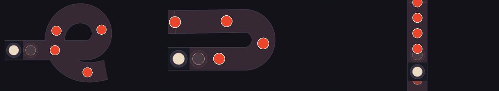

<div align="center">


# taiko-rs

**A small, fast osu!taiko client written in Rust.**

Linux (Wayland) · Windows · Android

[](https://github.com/Lynerrr/taiko-rs/releases/tag/latest)
[](https://github.com/Lynerrr/taiko-rs/actions/workflows/release.yml)
[](https://github.com/Lynerrr/taiko-rs/releases)




</div>

## Install

| Platform | |
| --- | --- |
| 🐧 **Linux** | `curl -fsSL https://raw.githubusercontent.com/Lynerrr/taiko-rs/worktree-taiko-client/install.sh \| sh` |
| 🪟 **Windows** | `irm https://raw.githubusercontent.com/Lynerrr/taiko-rs/worktree-taiko-client/install.ps1 \| iex` |
| 🤖 **Android** | grab `taiko-rs-android.apk` from the [latest release](https://github.com/Lynerrr/taiko-rs/releases/tag/latest) (8.0+, arm64) |

No root or admin needed. It finds your osu! Songs folder (osu-winello and Wine too); if yours is
somewhere else, point it there in Settings → Library. You can also drop `.osz` files in. The game updates itself (**Ctrl+U**). Dev builds are one switch away in
Settings → Updates.

## Highlights

- **Smooth and accurate.** The game clock is steered by the audio device, keys are timestamped on
  their own thread, and everything is drawn in one GPU call. Audio goes out through PipeWire,
  WASAPI or AAudio with low latency.
- **Your osu! library.** Taiko maps and osu!standard converts, lazer's conversion and hit windows,
  osu!'s star ratings, and collections and play history from osu!stable.
- **73 mods.** osu!'s and lazer's mods, plus taiko-rs's own: scroll and SV experiments, visual
  tricks, lanes bent into rails, a moving playfield, and Multiverse's eight playfields, each with
  its own note colours, shapes, speed and mods. **C** in the mod select customizes the mods that have
  settings (Multiverse, Shapeshift) while they are on. Press **R**
  in the mod select for a playable random set.
- **Online.** Lobbies on the taiko-rs server or direct P2P, live scoreboards, spectating, friends,
  chat, and watching friends' solo plays.
- **Everything else.** osu! skins, map downloads from mirrors, local replays with video export,
  offset calibration, a custom playfield size, UI colours and Discord status.

## Keys

| | | | |
| --- | --- | --- | --- |
| `D` `F` `J` `K` | rim · don · don · rim | `F1` | mods |
| `Esc` | pause | `F2` | random song |
| `` ` `` / `Ctrl+R` | restart | `[` `]` | speed −/+ |
| `Space` | skip intro | `F3` `F4` | scroll speed |
| `Tab` | songs ⇄ settings | `F9` | friends & chat |
| `Shift+Tab` | hide the interface in a song | `Ctrl+C` `Ctrl+V` | copy · paste |

Everything is clickable too. The drum keys can be rebound in Settings → Input, and on touch
screens the screen becomes four drum columns.

## Build

```sh
cargo build --release
./target/release/taiko-rs              # your osu! Songs folder
./target/release/taiko-rs map.osz      # or any .osz / .osu / folder
```

You'll need `clang` and the PipeWire headers (or build with `--no-default-features` for ALSA
only). The APK is built with `android/build-apk.sh`, and the online server lives in `server/`.

<div align="center">
<sub>📖 The <a href="README1.md">full guide</a> covers every setting, mod and screen.</sub>
</div>
