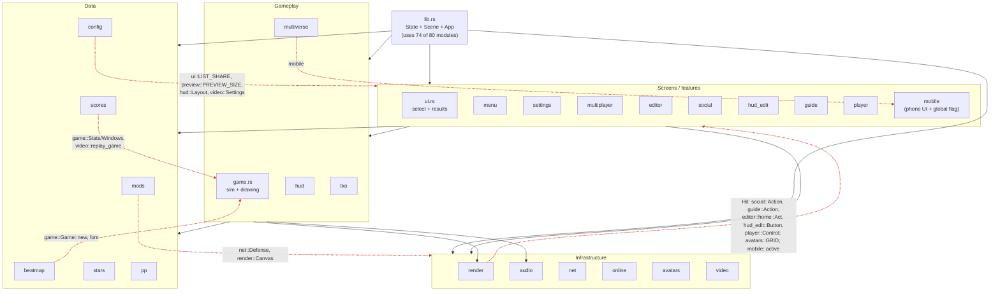
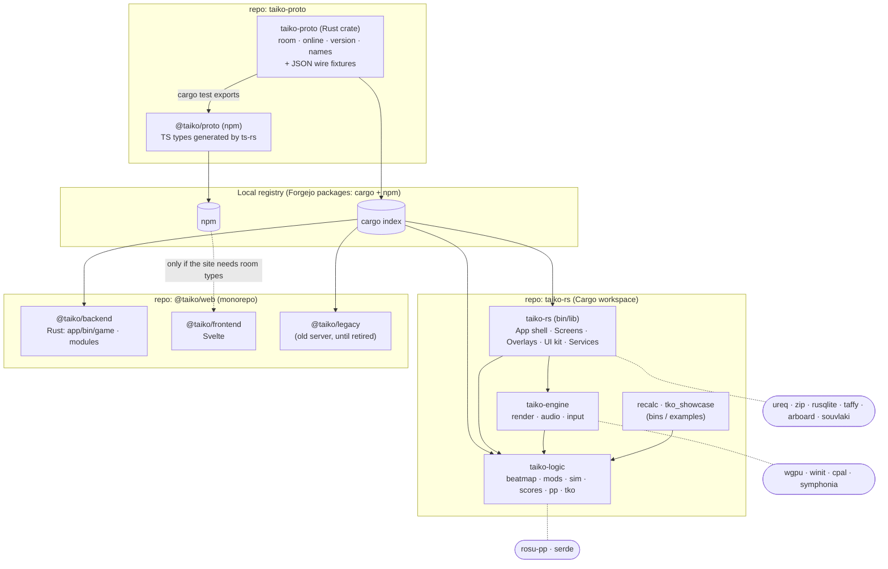
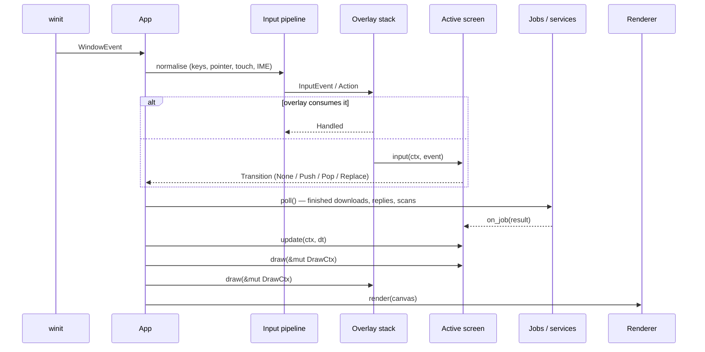
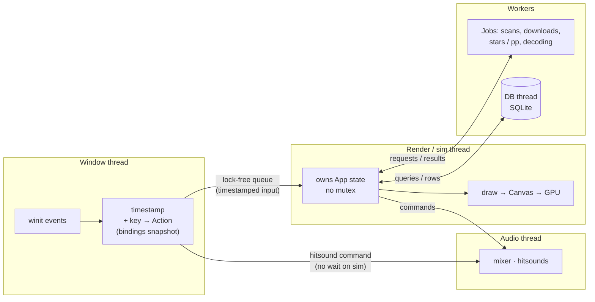

# Client architecture: where it is and where to take it

A refactoring plan for the game client (`src/`). The numbers are measured on `dev` at f696320
(161k lines in 154 files). The server is out of scope except for the code it borrows from the
client.

- [1. Where we are](#1-where-we-are)
- [2. Target layers](#2-target-layers)
- [3. Component diagram (target)](#3-component-diagram-target)
- [4. Modules to extract](#4-modules-to-extract)
- [5. Dependency rules](#5-dependency-rules)
- [6. Migration plan](#6-migration-plan)
- [7. How we know it worked](#7-how-we-know-it-worked)

**Review round 1 (2026-11-08).** Where each point raised in review is answered:

| Point | Answer |
|---|---|
| `proto` as its own repository, built into a package in a local registry, next to the `@taiko/web` monorepo | [4.1](#41-taiko-proto-its-own-repository): repo `taiko-proto`, Rust crate + generated `@taiko/proto` TS types, Forgejo cargo/npm registry |
| Is there a ready UI library that fits? | [4.9](#49-ui-library-take-one-or-keep-ours): taffy for layout under our own widgets; egui only for tool panels; iced/Slint/clay/Xilem compared and rejected |
| Mods, screens and effects must be easy to add | [4.10](#410-extension-points-mods-screens-effects): `ModDef` registry + per-play pipeline, `Screen` trait, `Effect` registry |
| Performance is the main focus | [4.12](#412-performance-first): drop the shared `State` mutex from the input path, hot-path rules, perf gate in CI |
| SQLite for local data (map index, scores) with search and filtering | [4.11](#411-local-data-in-sqlite): `rusqlite` bundled + FTS5, schema, import of the old files |

---

## 1. Where we are

### 1.1 Shape of the code

One crate, flat: 80 modules sit directly under `src/`, two have subfolders (`editor/`, `tko/`).
There's no `trait` anywhere in the client, and no Cargo workspace.

| Hot spot | Size | What's in it |
|---|---|---|
| `lib.rs` | 21,044 lines | `State`, `Scene`, the winit `App`, the render loop, GPU start, crash reports, ~120 free drawing/helper functions |
| `struct State` | ~220 fields | config, library, audio, every screen's state, every overlay's state, 15+ `Receiver`s of background jobs, window/input bookkeeping |
| `impl State` | 353 methods, ~16k lines | `build_frame` 2,454 lines, `key_inner` 727, `click` 484, `multiplayer_key` 440, `mouse_button` 406, `mp_menu_key` 395 |
| `enum Scene` | 24 variants, 534 `Scene::` mentions in `lib.rs` | screens; `back: Box<Scene>` fields act as an ad-hoc navigation stack |
| `game.rs` | 11,547 lines | judging, scoring, rewind **and** all playfield drawing; `draw_field` alone is 1,671 lines |
| `editor/view.rs` | 8,130 lines | the editor's whole UI |
| `render.rs` | 4,171 lines | wgpu, shaders, `Canvas`, **and** `enum Hit` (103 variants from every screen) |
| globals | 79 `static`/`thread_local!` | accent, animations, pulse/kiai, note colours, `mobile::active`, language… |

### 1.2 Current dependencies (simplified)

Arrows are `crate::` uses. Red arrows point *down the stack the wrong way*: a low-level module
that knows about a screen.



Most-depended-on modules (fan-in from other modules, not counting `lib.rs`): `render` 39,
`mobile` 20, `config` 20, `game` 18, `online`/`beatmap`/`mods` 14. `mobile` being second is a
smell: it's there for `mobile::active()`, a global "are we on a phone" flag.

### 1.3 The problems that hurt

1. **God object.** Any feature touches `State` and `lib.rs`; every PR conflicts there. A new
   screen means new fields, new arms in `build_frame`/`key_inner`/`click`/`mouse_button`/`wheel`,
   and new `poll_*` calls.
2. **No layering.** The renderer knows screen actions, config knows UI constants, data knows
   gameplay. Nothing can be built or tested without the rest.
3. **Simulation and drawing are fused** in `Game`. A replay or pp recalculation drags in the
   renderer; a test of judging needs a `Canvas`.
4. **Process-wide drawing globals** (`ACCENT`, `ANIMATIONS`, `PULSE`/`KIAI`, `HIDE_GREAT`,
   `HIT_FLASH`, `NOTE_COLOURS`, `mobile::active`, …) race in parallel tests; we already patch
   that with `pin_*_for_this_thread`.
5. **Settings wiring is scattered:** one new option touches `settings.rs` (enum, `ITEMS` and its
   `N`, label, kind, help), `settings_search.rs`, four hooks in `lib.rs`, and `config.rs`
   (field, default, parse, save).
6. **Background jobs are ad hoc:** each one is an `Option<Receiver<…>>` field plus a hand-written
   `poll_*` method in `impl State`.
7. **The server borrows client files** with `#[path = "../../src/…"]` (`net.rs`, `online.rs`,
   `lang.rs`, `font.rs`, `tls.rs`, `changelog_entry.rs`) under `#[allow(dead_code)]`. A client
   edit can break the server build, and the server compiles client-only code.

---

## 2. Target layers

Seven layers. A layer may use the ones below it, never the ones above.

| # | Layer | Responsibility | Must not know about |
|---|---|---|---|
| 7 | **App shell** | winit `App`, event loop, frame pacing, GPU start, crash reports, screen router, overlay stack | how any screen looks |
| 6 | **Screens** | one module per screen: its state, input handling, drawing, transitions | other screens' internals |
| 5 | **Overlays** | things over any screen: social (F9), volume, toasts, quit/crash dialogs, guide, idle | which screen is under them |
| 4 | **UI kit** | widgets and theme: lists, scrollbars, dropdowns, text fields, buttons, panels, `Theme`, `FormFactor` | screens |
| 3 | **Services** | I/O and background work: library scan, downloads, online client, multiplayer session, skins, avatars, updater, Discord, media keys | drawing |
| 2 | **Engine** | `render` (wgpu, `Canvas`, atlases), `audio` (output, mixer, stream, clock), input mapping (`keys`) | the game's rules, screens |
| 1 | **Logic** | pure logic and formats: beatmap, mods, judging/scoring, replays, stars/pp, search, `.tko` model and runtime | wgpu, winit, cpal, threads, files* |
| 0 | **Proto** | wire types shared with the servers (separate repo, see 4.1): room messages, online API, version, name rules | anything client-side |

\* Logic may parse bytes it's handed; opening files and folders belongs to services.

---

## 3. Component diagram (target)

### 3.1 Crates



`taiko-engine` depending on `taiko-logic` is only for small shared types (`Speed`, timing); if it
turns out to be more than that, flip it and keep the engine logic-free. The client crate is called
`taiko-logic`, not `taiko-core`, because `@taiko/backend` already has a `taiko-core` and both end
up next to each other in one registry.

### 3.2 Components inside the client

```mermaid
flowchart TB
    subgraph L7[7 · App shell]
        appmain["App<br/>(winit ApplicationHandler)"]
        frameloop["Frame loop<br/>pacing · present · shots"]
        router["Screen router<br/>stack of Screen"]
        inputpipe["Input pipeline<br/>winit → InputEvent → Action"]
        crash["Crash reports<br/>gpu_start · native_crashes"]
    end

    subgraph L5[5 · Overlays]
        ov_social["Social (F9)"]
        ov_volume["Volume"]
        ov_toast["Toasts"]
        ov_quit["Quit / crash dialog"]
        ov_guide["Guide"]
        ov_idle["Idle screen"]
    end

    subgraph L6[6 · Screens]
        s_splash["Splash"]
        s_menu["Main menu<br/>+ music player"]
        s_select["Song select<br/>+ preview + leaderboard"]
        s_play["Play<br/>(solo / replay / test play)"]
        s_results["Results"]
        s_settings["Settings<br/>+ calibrate · layout · HUD edit"]
        s_download["Download / browse"]
        s_mp["Multiplayer<br/>menu · lobby · wait · play · results"]
        s_watch["Spectate / watch"]
        s_guessr["Mapguessr"]
        s_video["Video editor"]
        s_editor["Map editor<br/>home · view"]
        s_profile["Profile · medals · changelog"]
    end

    subgraph L4[4 · UI kit]
        theme["Theme<br/>accent · pulse · animations"]
        widgets["Widgets<br/>list · scrollbar · dropdown<br/>text field · button · panel"]
        layoutk["Layout<br/>taffy (flex / grid)"]
        formfactor["FormFactor<br/>desktop / phone"]
        drawctx["DrawCtx<br/>Canvas + Theme + time"]
    end

    subgraph L3[3 · Services]
        sv_cfg["Config store<br/>load · save · migrate"]
        sv_lib["Library<br/>scan · osu!.db · folder watch"]
        sv_dl["Downloads<br/>mirrors · custom maps · set status"]
        sv_online["Online client<br/>accounts · boards · submits"]
        sv_mp["MP session<br/>room over TCP"]
        sv_assets["Assets<br/>skins · avatars · pictures · backgrounds"]
        sv_sys["System<br/>updater · Discord · media keys<br/>clipboard · links · DnD"]
        sv_jobs["Jobs<br/>spawn · poll · cancel"]
        sv_store[("Local store<br/>SQLite: maps · scores · plays<br/>per-map settings · set status")]
    end

    subgraph L2[2 · Engine]
        en_render["Renderer<br/>wgpu · Canvas · atlases · shaders"]
        en_audio["Audio<br/>engine · mixer · stream · clock"]
        en_keys["Key bindings<br/>KeyCode → Action"]
    end

    subgraph L1[1 · Logic]
        c_map["Beatmap<br/>.osu parse · convert"]
        c_mods["Mod registry<br/>ModDef · ModPipeline"]
        c_sim["Sim<br/>judge · score · rewind · autoplay"]
        c_scores["Scores & replays"]
        c_pp["Stars · pp · difficulty"]
        c_search["Search query<br/>osu! filters → SQL"]
        c_tko["TKO<br/>format · graph · runtime<br/>effect registry"]
    end

    subgraph L0["0 · Proto (external crate)"]
        p_net["Room messages"]
        p_online["Online API types"]
    end

    appmain --> frameloop --> router
    appmain --> inputpipe --> router
    inputpipe --> L5
    router --> L6
    L5 --> L4
    L6 --> L4
    L6 --> L3
    L6 --> L1
    L4 --> en_render
    L3 --> L1
    L3 --> L0
    sv_online --> p_online
    sv_mp --> p_net
    s_play --> c_sim
    s_play --> en_audio
    s_editor --> c_tko
    c_sim --> c_map & c_mods
    c_scores --> c_sim
    c_pp --> c_map & c_mods
    sv_lib --> sv_store
    sv_store --> c_search
```



### 3.3 One frame, after the refactor



---

## 4. Modules to extract

### 4.1 `taiko-proto`: its own repository

The protocol has three users in two repositories: the client (`taiko-rs`), the new game server
(`@taiko/backend`, `apps/backend/app/src/game.rs`, which declares its own serde types today) and
the old one (`server/` here, `apps/legacy` in `@taiko/web`, which include `src/net.rs` by
`#[path]`). So it gets its own repository, `taiko-proto`, published as a package to a local
registry, and every user depends on a version of it.

**What goes in** — only what crosses the wire:

| From | To | Notes |
|---|---|---|
| `net.rs` (types) | `taiko_proto::room` | `ClientMsg`/`ServerMsg`, `RoomSettings`, `MapInfo`, `Defense`, `Hello`. The TCP loop stays in the client (`services::mp`) and in the backend |
| `online.rs` (types) | `taiko_proto::online` | requests/replies, `OnlineScore`, `Profile`, `Reply::Joined`. The `ureq`/socket code stays in the client (`services::online`) |
| `PROTOCOL` constants | `taiko_proto::VERSION` | one number both sides compare in the handshake |
| `font::drawable` (as used for names) | `taiko_proto::names` | the name/chat rules both sides check |
| — | `fixtures/*.jsonl` | one golden JSON line per message variant; both sides' CI parse and re-serialise them |

**What stays out:** `lang.rs` (localisation is the client's; the server should send codes, the
client words them), `tls.rs` (connection setup differs per side; the host is client config),
`font.rs` glyphs, `changelog_entry.rs` (client data).

**Packaging:**

- Rust crate `taiko-proto` (serde only, no I/O) → the local **cargo** registry.
- TS types `@taiko/proto`, generated from the same Rust types with `ts-rs` (12.x) in the crate's
  tests → the local **npm** registry. Only needed if the site or bot reads room/online messages;
  the HTTP API keeps its OpenAPI client (`libs/api-client`, orval).
- Registry: one **Forgejo/Gitea** instance hosts both a cargo and an npm registry (alternative:
  kellnr for cargo + Verdaccio for npm). It can run next to the rest of `apps/infra`.
- Versioning: semver. A change that an old peer can't parse is a major bump and bumps `VERSION`;
  adding an optional field is a minor bump. Tags `v1.2.0` publish both packages from CI.

**Things to settle before step 1:**

- The client's CI is on GitHub Actions (release.yml builds Linux, Windows, macOS and Android).
  The runners must reach the registry: public read access, or a token in
  `CARGO_REGISTRIES_TAIKO_TOKEN`. Same for anyone building the client from source; if the
  registry is private, outside contributors can't build. Fallback that needs no infra:
  `taiko-proto = { git = "…/taiko-proto", tag = "v1.2.0" }`.
- `Cargo.lock` pins the exact version, so a registry outage never changes a release build.

Payoff: no more `#[path]` + `#[allow(dead_code)]` in the server, the backend stops keeping its
own copy of the message types, and a wire change is one reviewed diff with fixtures.

### 4.2 `taiko-logic` (pure logic)

| From | To | Notes |
|---|---|---|
| `beatmap.rs` | `logic::beatmap` | cut the `game::Game::new` and `font::drawable` uses |
| `mods.rs`, `od_override.rs`, `tact.rs`*, `shapeshift.rs`*, `multiverse.rs`* | `logic::mods` | *only the setup data and its parse/format; their drawing and pickers go to screens |
| `game.rs` (judging part) | `logic::sim` | `Judge`, `Stats`, `Windows`, `WindowRule`, `Mash`, `Scoring`, `NoteState`, `judge_press`, `expire`, `update`, `rewind`, `with_half`, defense rules |
| `autoplay.rs` | `logic::sim::autoplay` | |
| `scores.rs` | `logic::scores` | replay format and score rows; file I/O moves to a service |
| `stars.rs`, `pp.rs`, `difficulty.rs`, `recalc.rs` | `logic::rating` | `recalc` becomes a small bin |
| `search.rs`, `mapinfo.rs`, `genres.rs` | `logic::library` | the query language and sort keys |
| `tko/{format,graph,runtime,track,path,scroll,gimmick,clips}` | `logic::tko` | `tko::screen`/`recipes` that produce shapes stay on the engine side |
| `calibrate.rs` (estimate) | `logic::calibrate` | the math only |

Rule enforced by Cargo: `taiko-logic` has no `wgpu`, `winit`, `cpal`, `ureq`.

### 4.3 `taiko-engine`

| From | To | Notes |
|---|---|---|
| `render.rs` | `engine::render::{gpu, canvas, atlas, bg, shaders, hit}` | `Hit` becomes generic (see 4.6) |
| `layout.rs` | `engine::render::viewport` | playfield rectangle math |
| `audio.rs`, `stream.rs`, `clock.rs`, `audiolog.rs` | `engine::audio::{engine, mixer, stream, clock, log}` | |
| `medal_sound.rs` | `engine::audio::synth` | |
| `keys.rs` | `engine::input::bindings` | `Config` access through a small trait or a plain struct |
| `debug.rs` (frame stats) | `engine::diag` | screenshot encoding too |

### 4.4 `src/game.rs` → `src/play/`

`Game` keeps a `logic::sim::Run` and adds everything visual:

```
play/
  mod.rs        Game = Run + View state; frame update
  field/        draw_field split: lanes, notes, rails, scroll, focus, crumbs, echo, layers
  modes/        defense, multiverse, maze, shapeshift, tact (visual parts)
  hud.rs        draw_hud, health, hit error, combo (today's hud.rs + game::draw_hud)
  effects.rs    tko screen effects, flashes, glitch
```

`draw_field` (1,671 lines) is the first target: split by what it draws, keep the existing golden
tests green after each cut.

### 4.5 `src/lib.rs` → `src/app/` + `src/screens/` + `src/overlays/`

```
app/
  mod.rs          desktop_main, android_main, run
  shell.rs        App, ApplicationHandler, UserEvent
  frame.rs        render_loop, pacing, vsync, screenshots
  router.rs       Screen trait, Transition, screen stack
  input.rs        winit → InputEvent → Action; modifiers, IME, touch-to-mouse
  ctx.rs          Ctx { cfg, audio, services, theme, form_factor, now }
  gpu_start.rs    backends, drawing-hook detection
  crash.rs        log_crashes, native_crashes, send_crash_report
screens/
  select/         from ui.rs + lib.rs (leaderboard, preset naming, preview chrome, set check)
  results/        from ui.rs + results_job, submit_score, fetch_replay
  play/           solo play, replay bar, pause, retry, fail
  settings/       settings.rs, settings_search.rs, calibrate, layout edit, hud_edit
  menu/           menu.rs, menu_notes.rs, player.rs, playlist.rs
  download/       browse.rs + download_key
  multiplayer/    multiplayer.rs + mp_menu_key, multiplayer_key, handle_server_msg
  watch/          SpectateView, WatchView, watch_tick
  guessr/         mapguessr.rs
  video/          video.rs editor + export
  editor/         editor/ as is (already a subtree)
  profile/        profile.rs, medals.rs, changelog.rs
  mobile/         phone variants of the screens above (see 4.8)
overlays/
  social/         social.rs + social_key/social_down/social_action + admin.rs + shots.rs
  volume.rs  toast.rs  quit.rs  crash.rs  guide.rs  idle.rs  splash.rs
services/
  config/         config.rs persistence; data folder moves (move_data_to)
  library/        library.rs, osudb.rs, folder_watch.rs, scan, installed sets
  downloads/      download.rs, custom.rs, setstatus.rs, poll_downloads, add_downloaded
  online/         online client, boards, submits, pp backfill, loved/custom calls
  mp/             TCP room session, host map transfer
  assets/         skin.rs, avatars.rs, pictures.rs, backgrounds
  system/         update.rs, discord.rs, media.rs, clipboard.rs, link.rs, wayland_dnd.rs, android.rs
  jobs.rs         Job<T>
  store/          SQLite: schema, migrations, import of the old files, typed queries (4.11)
ui_kit/
  theme.rs (style.rs + accent/pulse/kiai)  cursor.rs  logo.rs  drum_nav.rs  layout.rs (taffy, 4.9)
  list.rs  scrollbar.rs  dropdown.rs  text_field.rs  button.rs  panel.rs
```

### 4.6 Seams to introduce

These are the few abstractions that make the split possible. Each is small.

**`Screen` and `Transition`** — replaces `enum Scene` matches and `back: Box<Scene>`.

```rust
pub trait Screen {
    fn input(&mut self, ctx: &mut Ctx, ev: &InputEvent) -> Transition;
    fn update(&mut self, ctx: &mut Ctx, dt_ms: f64) -> Transition { Transition::None }
    fn draw(&self, ctx: &Ctx, d: &mut DrawCtx);
    fn on_job(&mut self, ctx: &mut Ctx, done: JobDone) -> Transition { Transition::None }
    fn presence(&self) -> Option<discord::Activity> { None }
    fn shows_own_background(&self) -> bool { false }
}

pub enum Transition {
    None,
    Push(Box<dyn Screen>),
    Pop,
    Replace(Box<dyn Screen>),
    Quit,
}
```

If dynamic dispatch is a concern on the hot path, keep an `enum AnyScreen` that implements
`Screen` by delegating — the call sites look the same.

**Generic hit-testing** — `render::Hit` (103 variants from every screen) becomes per-screen:

```rust
pub struct HitBox<A> { pub rect: [f32; 4], pub action: A, shape: usize }
pub struct Canvas<A = ()> { pub shapes: Vec<Shape>, pub hits: Vec<HitBox<A>>, /* … */ }
```

Each screen defines `enum SelectAction { … }` next to its own code. The renderer stops importing
`social`, `guide`, `editor`, `hud_edit`, `player`.

**`DrawCtx` / `Theme` instead of globals** — accent, animations, pulse/kiai, `HIDE_GREAT`,
`HIT_FLASH`, note colours, text grid, legacy menu and form factor travel with the canvas. The
window thread that needs the accent for the pointer gets a copy through the event proxy. The
`pin_*_for_this_thread` test hooks go away.

**`Job<T>`** — one type for every background call:

```rust
pub struct Job<T> { rx: Receiver<T>, started: Instant, label: &'static str }
impl<T: Send + 'static> Job<T> {
    pub fn spawn(label: &'static str, f: impl FnOnce() -> T + Send + 'static) -> Self;
    pub fn poll(&mut self) -> Option<T>;
}
```

Services own their jobs and expose events (`DownloadFinished`, `BoardFetched`, …) that the
router hands to the active screen. The 15+ `Option<Receiver<…>>` fields and most `poll_*`
methods leave `State`.

**Settings registry** — one table entry per option instead of eight edits:

```rust
pub struct SettingDef {
    pub key: &'static str,             // config.txt key
    pub label: fn() -> &'static str,   // tr!(…)
    pub help: fn() -> &'static str,
    pub keywords: &'static [&'static str],
    pub section: Section,
    pub kind: Kind,                    // Toggle / Choice(&[..]) / Number{..} / Text / Key / Path
    pub get: fn(&Config) -> Value,
    pub set: fn(&mut Config, Value),
}
pub static SETTINGS: &[SettingDef] = &[ /* … */ ];
```

`config.rs` parse/save, the settings list, the search and the four `lib.rs` hooks all iterate
the table. Adding an option = one entry + one `Config` field.

### 4.7 Config

- `Config` (2,281 lines) splits into sections (`Audio`, `Gameplay`, `Display`, `Interface`,
  `Online`, `Editor`, `Paths`) with the flat `key = value` file kept as is — no migration for
  players.
- Types that live in screens today and are stored in config (`hud::Layout`, `video::Settings`,
  `skin::Sources`, `ui::LIST_SHARE`, `preview::PREVIEW_SIZE`, `PresentChoice`) move to config or
  to core, so config stops depending on the UI.

### 4.8 Phone UI

`mobile.rs` is both a global flag and a parallel set of phone layouts (song select, mods,
settings, downloads). Keep the parallel layouts, but:

- `mobile::active()` → `ctx.form_factor` (one value, set at startup, readable in tests).
- Each screen gets `draw_desktop`/`draw_phone` (or a `phone.rs` next to it) instead of
  `mobile.rs` knowing about every screen.

### 4.9 UI library: take one or keep ours?

What a library would have to keep: the pixel look (5x7 LCD font, 480-unit virtual screen,
accent theming), one instanced GPU pass for everything, the golden screen tests that compare
`Shape` lists, drum navigation (menus driven by don/kat, not only a pointer), phone layouts,
and our own event loop and frame pacing.

| Option (version checked 2026-11) | Model | Fits our stack | Verdict |
|---|---|---|---|
| **taffy** 0.15 | layout engine only (flexbox, grid, block) | renderer-agnostic, no event loop, pure Rust, used by Bevy/Dioxus/Zed | **Take it** for layout under our own widgets |
| **egui** 0.37 (+ `egui-wgpu`, `egui-winit`) | immediate mode, full widget set, IME, text editing | same wgpu 30 + winit 0.30 as ours; paints into our render pass | **Maybe, for tools only**: editor side panels, debug/perf overlays. Not for menus or gameplay: a second look, TTF text, its own focus model |
| iced 0.14 | Elm-style, retained | owns the event loop and renderer | No: rewrite of every screen and the loop |
| Slint 1.18 | `.slint` DSL, own renderer | can render via wgpu, but a separate UI language and licence terms (GPLv3 / royalty-free with attribution / paid) | No |
| clay-layout 0.4 | immediate-mode layout (C library via FFI) | last release 2025-06, FFI on Android/Windows | No: taffy does the same in Rust |
| Xilem / Masonry 0.4 | retained, reactive | early, API still moving | No |

**Recommendation:** no drop-in library keeps the look, the speed and the tests at once. Build a
small `ui_kit` ourselves on top of `Canvas` and let **taffy** do the layout:

```rust
// A screen describes boxes; taffy computes rects; widgets draw into them with our Canvas.
let mut ui = ui_kit::Frame::new(ctx, canvas);            // owns a reused taffy tree
let root = ui.column(Style { gap: 6.0, padding: 8.0, ..Style::DEFAULT });
let list = ui.child(root, Style { flex_grow: 1.0, ..Style::DEFAULT });
let bar  = ui.child(root, Style { height: Length::Units(24.0), ..Style::DEFAULT });
ui.compute();                                            // one taffy pass per frame (or on change)
SongList::draw(&mut ui, list, &select.rows);             // our widget, our look
ButtonRow::draw(&mut ui, bar, &[Mods, Random, Options]);
```

Why it's compatible with what we have: drawing stays immediate mode into the same `Canvas`, the
golden tests keep comparing the same shapes, and screens move to it one at a time — taffy only
replaces the hand-computed coordinates (`LIST_TOP`, `BUTTONS_Y`, the right column's 436…) that
`layout_tests.rs` (2,677 lines) has to police at every aspect ratio. The widget set we need is
small: list with virtual scrolling, scrollbar, button/button row, tabs, dropdown, text field
(with IME), slider, toggle, panel/window, tooltip, toast.

### 4.10 Extension points: mods, screens, effects

Goal: adding a mod, a screen or an effect is **one new file plus one line in a registry**, with
no `match` arms to add anywhere else.

Today:

- **Mods** — `enum Mod` has 79 variants and `Mod::X` checks outside `mods.rs` number 185 in 7 files (101 in
  `game.rs`, 28 in `lib.rs`, 26 in `pp.rs`). A new mod touches the enum, judging, drawing, the
  picker, pp/stars and medals.
- **Screens** — a new screen is a `Scene` variant plus arms in `build_frame`, `key_inner`,
  `click`, `mouse_button`, `wheel`, `presence_text`… (section 1.3).
- **Effects** — `.tko` effects are fixed fields of `tko::runtime::FieldFx` and variants of
  `Prop` (116 uses in `runtime.rs`); a new effect touches the struct, `Prop`, the format parser,
  the runtime, `tko::screen` and the editor's node and motion views.

**Mods: a registry and a per-play pipeline.**

```rust
pub struct ModDef {
    pub id: ModId,                         // stable number: replays, medals, the server
    pub acronym: &'static str,             // "HD"
    pub name: fn() -> &'static str,        // tr!(…)
    pub group: Group,                      // Reduction / Increase / Fun / taiko.rs
    pub conflicts: &'static [ModId],
    pub ranked: bool,
    pub settings: Option<&'static dyn ModSettings>, // tact, shapeshift, multiverse, OD override…
    pub hooks: Hooks,
}

#[derive(Default)]
pub struct Hooks {
    pub map: Option<fn(&mut Beatmap, &ModCtx)>,             // once at load: mirror, random, half
    pub windows: Option<fn(&mut Windows, &ModCtx)>,         // once: EZ/HR/OD override
    pub rate: Option<fn(&ModCtx) -> f64>,                   // once: DT/HT/custom speed
    pub judge: Option<fn(&mut JudgeCtx)>,                   // per hit
    pub scroll: Option<fn(&mut ScrollState, f64)>,          // per frame
    pub note_alpha: Option<fn(&NoteView, f64) -> f32>,      // per visible note: HD, FL
    pub field: Option<&'static dyn FieldLayer>,             // drawing: multiverse, maze, defense
    pub pp: Option<fn(&mut PpInput)>,
}

pub static MODS: &[&ModDef] = &[&easy::DEF, &hard_rock::DEF, &hidden::DEF, /* … */];
```

`ModPipeline::build(&mods)` runs once when a play starts and keeps only the hooks of the mods
that are on, in a fixed order. The hot path then calls a short list of function pointers instead
of asking `mods.has(Mod::X)` dozens of times per note. The picker, the search keywords, the
conflict checks, replays and pp all read `MODS`.

**Screens:** the `Screen` trait from 4.6, plus a `ScreenId` list used by navigation, deep links
(`taiko-rs://`), Discord presence and crash context.

**Effects:** one trait, one registry; the format, the runtime and the editor read it.

```rust
pub trait Effect: Sync {
    fn id(&self) -> &'static str;                 // name in the .tko file: "glitch"
    fn params(&self) -> &'static [Param];         // name, range, default, unit → editor UI + parser
    fn stage(&self) -> Stage;                     // Local (playfield) / Screen (whole frame)
    fn apply(&self, canvas: &mut Canvas, from: usize, values: &[f32], t: f64);
}
pub static EFFECTS: &[&dyn Effect] = &[&Flash, &Vignette, &Wash, &Glitch, &Chroma, &Echo, &Kaleido];
```

`FieldFx` becomes "transform + a small array of active effect values", the node graph's palette
and the motion view's tracks are generated from `params()`, and `.tko` keeps its text format
(unknown effect names are kept and ignored, so an old client can open a newer map).

Rule: **no `match` over all mods, screens or effects outside their registry.** A CI grep can
enforce it for `Mod::` outside `mods/`.

### 4.11 Local data in SQLite

Today the client keeps its data in about ten files with their own formats:

| File | What |
|---|---|
| `library.json` (cache dir) | scanned library cache |
| `scores.tsv` + one replay file per play | local scores |
| `plays.tsv` | play counts |
| `hidden.tsv` | hidden maps |
| `map_offsets_osu.tsv` | per-map offsets |
| `map_skins_off.txt` | maps whose skin is off |
| `favourite-songs.txt` | the music player's favourites |
| `set-status.tsv` (cache dir) | ranked/loved status from the mirrors |
| `config.txt` | settings |

Plus star ratings and map info worked out again in the background (`mapinfo`, `stars`), and
search done in memory over `Vec<Entry>` (`search.rs`).

**Target:** one database file `taiko.db` in the data folder, behind `services::store`, the only
module that writes SQL.

- Crate: `rusqlite` 0.41 with the `bundled` feature (SQLite compiled into the binary: the same
  on Linux, Windows, macOS and Android, no system library), WAL mode, FTS5 for text search.
- Stays outside the DB: `config.txt` (players edit it by hand) and replay files (large blobs;
  the DB stores their paths).
- Migrations: `PRAGMA user_version` + embedded `.sql` files. The first run imports the old
  `.tsv`/`.json` files and leaves them in place as a backup.
- Threads: one DB thread owns the connection; screens send typed queries through `Job<T>` and
  get rows back. No SQL on the render thread.

```sql
CREATE TABLE maps (
  id INTEGER PRIMARY KEY, md5 TEXT UNIQUE NOT NULL, path TEXT NOT NULL, mtime INTEGER,
  set_id INTEGER, beatmap_id INTEGER, title TEXT, title_unicode TEXT, artist TEXT,
  artist_unicode TEXT, creator TEXT, version TEXT, source TEXT, tags TEXT,
  bpm REAL, length_ms INTEGER, notes INTEGER, od REAL, stars REAL, kind TEXT, -- osu / tko
  added_at INTEGER
);
CREATE VIRTUAL TABLE maps_fts USING fts5(title, title_unicode, artist, artist_unicode, creator,
  version, source, tags, content='maps', content_rowid='id');
CREATE INDEX maps_set ON maps(set_id);
CREATE INDEX maps_stars ON maps(stars);

CREATE TABLE scores (
  id INTEGER PRIMARY KEY, map_md5 TEXT NOT NULL, played_at INTEGER NOT NULL, score INTEGER,
  accuracy REAL, combo INTEGER, great INTEGER, ok INTEGER, miss INTEGER, pp REAL,
  mods TEXT, rate REAL, replay_path TEXT, online_id INTEGER
);
CREATE INDEX scores_map ON scores(map_md5, score DESC);

CREATE TABLE map_prefs (           -- plays.tsv, hidden, offsets, skins off, favourites
  map_md5 TEXT PRIMARY KEY, plays INTEGER DEFAULT 0, last_played INTEGER, hidden INTEGER DEFAULT 0,
  offset_ms REAL, skin_off INTEGER DEFAULT 0, favourite INTEGER DEFAULT 0
);
CREATE TABLE set_status (set_id INTEGER PRIMARY KEY, status TEXT, checked_at INTEGER);
```

Search: the osu!-style query parser in `search.rs` stays (it's the user-facing language) and
compiles `stars>5 status=r length<2:30 creator=x words` into `WHERE` clauses plus an FTS
`MATCH`. Song select still keeps an in-memory list of row ids for drawing (scrolling must never
wait for a query); the DB is where it comes from and where sorting/filtering run.

Things to know: +~1 MB binary; the regression suite opens an in-memory DB per test; Android
needs the DB in the app's data folder (already where `config::data_dir` points).

### 4.12 Performance first

Performance is the client's main requirement, so the refactor has rules of its own and fixes
the biggest structural problem on the way.

**The structural problem.** `State` lives in one `Arc<Mutex<State>>` shared by the window thread
(input) and the render loop. The [performance audit](performance-audit.md) found that the
largest pauses come from long work inside that lock, which keyboard events have to wait for.
The target threading model removes the shared lock from the input path:



**Rules for every refactor PR:**

1. **Static dispatch on hot paths.** Per note and per shape: no `dyn`, no `Box`, no `HashMap`
   lookups. `dyn Screen` is fine (called a few times per frame); mod hooks are function
   pointers prepared once per play (4.10).
2. **No allocations per frame** on steady screens: `Canvas`, hit lists and taffy trees are
   reused (`clear()` keeps capacity).
3. **Nothing blocking on the render thread:** no file I/O, no SQL, no decoding, no network —
   all through `Job<T>`/the DB thread.
4. **Work proportional to what's visible**, not to the library size (the song select lesson:
   cache by a version number, recompute only on change).
5. **Measured, not assumed:** each PR that touches play, select, the editor or the frame loop
   posts `perf_audit` numbers before/after (`cargo test --profile perf-audit --locked --lib
   perf_audit:: -- --ignored --nocapture --test-threads=1`).

**A perf gate in CI:** run the `perf_audit` cases on base and head on the same runner and fail
when a p95 gets more than 10 % worse (noise-checked with repeated runs first). Add cases that
don't exist yet: song select with 50k maps, a dense map's `draw_field`, the input → hitsound
latency through the new queue.

---

## 5. Dependency rules

Written down so review can enforce them; most become compile errors once the crates exist.

1. `taiko-proto` (separate repo) depends on serde only and knows nothing of the client or servers.
2. `taiko-logic` depends only on `taiko-proto`; no `wgpu`, `winit`, `cpal`, `ureq`, no
   `std::fs` outside explicit `from_bytes`/`to_bytes`.
3. `taiko-engine` doesn't import screens, services or config.
4. Services don't draw (no `Canvas` in their signatures).
5. Screens don't import other screens; they talk through `Transition` and shared services.
6. Overlays don't know the screen under them; a screen can only ask "is an overlay modal?".
7. No new `static mut`/`static` mutable globals in drawing code; state goes through `Ctx`/`DrawCtx`.
8. `lib.rs` holds only `mod` declarations and re-exports.
9. SQL lives only in `services::store`; nothing else opens `taiko.db`.
10. No `match` over every mod, screen or effect outside its registry (4.10).
11. The render thread never blocks on I/O, SQL, decoding or the network (4.12).

A cheap guard until the crates exist: a CI script (like `check-regression-tests.sh`) that greps
`use crate::` in `render.rs`, `config.rs`, `beatmap.rs`, `mods.rs`, `scores.rs` against an
allow-list.

---

## 6. Migration plan

Strangler style: the game keeps working after each step, each step is its own PR, and the
regression suite (`src/regression`, `cargo test --locked --all-targets`) is the safety net. No
step changes behaviour; if a golden changes, the step is wrong.

| Step | What | Risk | Unblocks |
|---|---|---|---|
| 0 | Fill gaps in the regression suite for what each step touches (input routing per scene, settings round-trip, mp messages); perf gate in CI with the missing `perf_audit` cases | low | everything |
| 1 | Registry up (Forgejo cargo + npm); repo `taiko-proto` with fixtures; client, `server/` and `@taiko/backend` switch to it | low | server/client independence |
| 1b | `services::store`: SQLite, schema, import of the old files; scores and per-map prefs first, then the library index and search | medium | fast search/filtering |
| 2 | Cut wrong-way deps: `render → screens` (generic `Hit`), `config → ui/preview/hud/video`, `beatmap → game`, `scores → video`, `mods → net/render`, `tko → editor` (test-only) | medium | crate split |
| 3 | Globals → `Theme`/`DrawCtx`/`FormFactor`; remove `pin_*` hooks | medium | parallel tests, crate split |
| 4 | Split `game.rs`: `logic::sim` vs `play::field`/`play::hud`; split `draw_field` | medium | `taiko-logic` |
| 5 | Extract `taiko-logic` crate (beatmap, mods, sim, scores, rating, search, tko model) | medium | headless tools, server pp |
| 6 | Move `lib.rs` free functions into the modules they draw for; `app/` for shell, loop, GPU start, crash reports | low | step 7 |
| 7 | `Screen` trait + router; migrate screens one at a time, simplest first: `CalibrateDone` → `Download` → `Settings` → `Profile/Medals` → `VideoEdit` → `Editor*` → `Watch/Spectate` → `Results` → multiplayer → `Select` → `Play` | high, but incremental | `State` shrink |
| 8 | Overlays out of `State` (social, volume, toast, quit, guide, idle) with an input stack | medium | |
| 9 | `Job<T>` + services; move `poll_*` and receivers out of `State` | medium | |
| 10 | Settings registry | medium | cheap new options |
| 11 | `taiko-engine` crate (render, audio, input) | low by then | |
| 12 | Threading: input on the window thread into a timestamped queue, hitsounds sent straight to audio, render thread owns the state (no `Mutex<State>`) | high | input latency |
| 13 | Mod registry + `ModPipeline`; move each mod into its own file | medium | cheap new mods |
| 14 | Effect registry; `FieldFx` → transform + effect values; editor palette from `params()` | medium | cheap new effects |
| 15 | `ui_kit` on taffy; move screens to it one at a time, starting with settings and download | medium | aspect-ratio bugs, phone layouts |

Steps 1, 1b, 2 and 3 can run in parallel; 4–5 and 6–7 are two independent tracks. 12 needs 7–9
(state split), 13–14 need 5, 15 needs 7.

During step 7 `Scene` and the router coexist: `Scene::Other(Box<dyn Screen>)` lets migrated
screens live next to the old match arms until the last one moves.

---

## 7. How we know it worked

| Metric | Now | Target |
|---|---|---|
| `lib.rs` | 21,044 lines | < 200 (mods + re-exports) |
| `State` fields | ~220 | < 30 (`Ctx` + router + overlays) |
| Longest function | 2,454 (`build_frame`) | < 300 |
| `game.rs` | 11,547 lines | no file over 2,000 |
| Wrong-way deps (section 1.2) | 6 groups | 0 |
| Mutable drawing globals | ~20 | 0 |
| Files touched to add a setting | 4 files, ~10 places | 1–2 |
| Server `#[path]` includes | 6 | 0 |
| `cargo test` for core logic | needs wgpu/winit to build | `cargo test -p taiko-logic` without them |
| Copies of the wire types | client `net.rs`/`online.rs` + backend `game.rs` | one `taiko-proto` version |
| Input → hitsound path takes the `State` lock | yes | no |
| `Mod::X` checks outside `mods/` | 185 in 7 files | 0 |
| Places to touch for a new effect | 5+ (struct, `Prop`, parser, runtime, screen, editor) | 1 file + registry line |
| Local data formats | ~9 files (`.tsv`/`.json`/`.txt`) | `taiko.db` + `config.txt` + replays |
| `perf_audit` p95, select (50k maps) / `draw_field` / input→sound | to measure in step 0 | never worse than base by > 10 % |

Measure again after each step and update this table.
