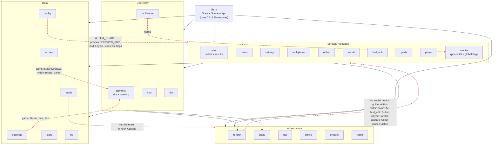
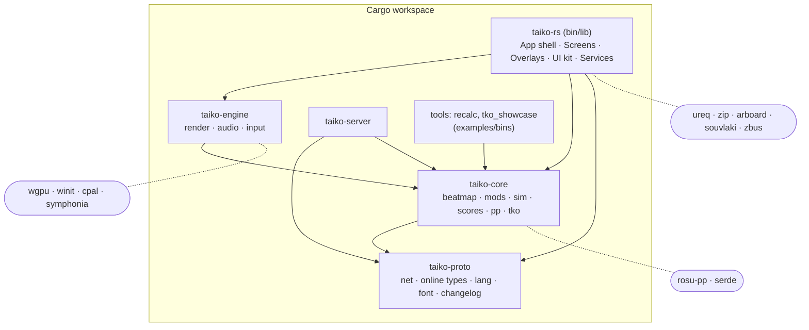
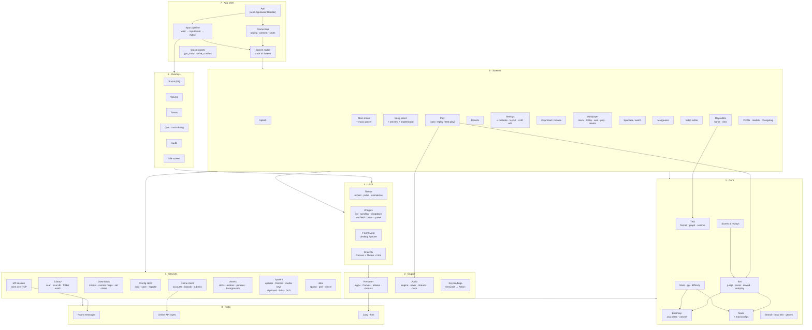
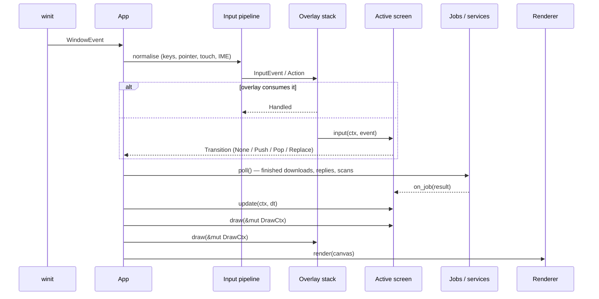

# Client architecture: where it is and where to take it

A refactoring plan for the game client (`src/`). The numbers are measured on `dev` at f696320
(161k lines in 154 files). The server is out of scope except for the code it borrows from the
client.

- [1. Where we are](#1-where-we-are)
- [2. Target layers](#2-target-layers)
- [3. Component diagram (target)](#3-component-diagram-target)
- [4. Modules to extract](#4-modules-to-extract)
- [5. Dependency rules](#5-dependency-rules)
- [6. Migration plan](#6-migration-plan)
- [7. How we know it worked](#7-how-we-know-it-worked)

---

## 1. Where we are

### 1.1 Shape of the code

One crate, flat: 80 modules sit directly under `src/`, two have subfolders (`editor/`, `tko/`).
There's no `trait` anywhere in the client, and no Cargo workspace.

| Hot spot | Size | What's in it |
|---|---|---|
| `lib.rs` | 21,044 lines | `State`, `Scene`, the winit `App`, the render loop, GPU start, crash reports, ~120 free drawing/helper functions |
| `struct State` | ~220 fields | config, library, audio, every screen's state, every overlay's state, 15+ `Receiver`s of background jobs, window/input bookkeeping |
| `impl State` | 353 methods, ~16k lines | `build_frame` 2,454 lines, `key_inner` 727, `click` 484, `multiplayer_key` 440, `mouse_button` 406, `mp_menu_key` 395 |
| `enum Scene` | 24 variants, 534 `Scene::` mentions in `lib.rs` | screens; `back: Box<Scene>` fields act as an ad-hoc navigation stack |
| `game.rs` | 11,547 lines | judging, scoring, rewind **and** all playfield drawing; `draw_field` alone is 1,671 lines |
| `editor/view.rs` | 8,130 lines | the editor's whole UI |
| `render.rs` | 4,171 lines | wgpu, shaders, `Canvas`, **and** `enum Hit` (103 variants from every screen) |
| globals | 79 `static`/`thread_local!` | accent, animations, pulse/kiai, note colours, `mobile::active`, language… |

### 1.2 Current dependencies (simplified)

Arrows are `crate::` uses. Red arrows point *down the stack the wrong way*: a low-level module
that knows about a screen.



Most-depended-on modules (fan-in from other modules, not counting `lib.rs`): `render` 39,
`mobile` 20, `config` 20, `game` 18, `online`/`beatmap`/`mods` 14. `mobile` being second is a
smell: it's there for `mobile::active()`, a global "are we on a phone" flag.

### 1.3 The problems that hurt

1. **God object.** Any feature touches `State` and `lib.rs`; every PR conflicts there. A new
   screen means new fields, new arms in `build_frame`/`key_inner`/`click`/`mouse_button`/`wheel`,
   and new `poll_*` calls.
2. **No layering.** The renderer knows screen actions, config knows UI constants, data knows
   gameplay. Nothing can be built or tested without the rest.
3. **Simulation and drawing are fused** in `Game`. A replay or pp recalculation drags in the
   renderer; a test of judging needs a `Canvas`.
4. **Process-wide drawing globals** (`ACCENT`, `ANIMATIONS`, `PULSE`/`KIAI`, `HIDE_GREAT`,
   `HIT_FLASH`, `NOTE_COLOURS`, `mobile::active`, …) race in parallel tests; we already patch
   that with `pin_*_for_this_thread`.
5. **Settings wiring is scattered:** one new option touches `settings.rs` (enum, `ITEMS` and its
   `N`, label, kind, help), `settings_search.rs`, four hooks in `lib.rs`, and `config.rs`
   (field, default, parse, save).
6. **Background jobs are ad hoc:** each one is an `Option<Receiver<…>>` field plus a hand-written
   `poll_*` method in `impl State`.
7. **The server borrows client files** with `#[path = "../../src/…"]` (`net.rs`, `online.rs`,
   `lang.rs`, `font.rs`, `tls.rs`, `changelog_entry.rs`) under `#[allow(dead_code)]`. A client
   edit can break the server build, and the server compiles client-only code.

---

## 2. Target layers

Seven layers. A layer may use the ones below it, never the ones above.

| # | Layer | Responsibility | Must not know about |
|---|---|---|---|
| 7 | **App shell** | winit `App`, event loop, frame pacing, GPU start, crash reports, screen router, overlay stack | how any screen looks |
| 6 | **Screens** | one module per screen: its state, input handling, drawing, transitions | other screens' internals |
| 5 | **Overlays** | things over any screen: social (F9), volume, toasts, quit/crash dialogs, guide, idle | which screen is under them |
| 4 | **UI kit** | widgets and theme: lists, scrollbars, dropdowns, text fields, buttons, panels, `Theme`, `FormFactor` | screens |
| 3 | **Services** | I/O and background work: library scan, downloads, online client, multiplayer session, skins, avatars, updater, Discord, media keys | drawing |
| 2 | **Engine** | `render` (wgpu, `Canvas`, atlases), `audio` (output, mixer, stream, clock), input mapping (`keys`) | the game's rules, screens |
| 1 | **Core** | pure logic and formats: beatmap, mods, judging/scoring, replays, stars/pp, search, `.tko` model and runtime | wgpu, winit, cpal, threads, files* |
| 0 | **Proto** | wire types shared with the server: rooms, online API, languages, font, changelog entries | anything client-side |

\* Core may parse bytes it's handed; opening files and folders belongs to services.

---

## 3. Component diagram (target)

### 3.1 Crates



`taiko-engine` depending on `taiko-core` is only for small shared types (`Speed`, timing); if it
turns out to be more than that, flip it and keep the engine core-free. `server → core` is
optional, for pp recalculation on the server (`recalc.rs` today).

### 3.2 Components inside the client



### 3.3 One frame, after the refactor



---

## 4. Modules to extract

### 4.1 `taiko-proto` (shared with the server)

| From | To | Notes |
|---|---|---|
| `net.rs` | `proto::room` | message enums, `RoomSettings`, `MapInfo`, `Defense`. The TCP client half stays in the app (`services::mp`) |
| `online.rs` | `proto::online` (types) + `services::online` (client) | the server needs the types, not the `ureq` calls |
| `lang.rs` | `proto::lang` | `tr!` macro and `ru_plural` |
| `font.rs` | `proto::font` | `drawable()` is used by both sides for name checks |
| `tls.rs` | `proto::tls` | server host/port and rustls setup |
| `changelog_entry.rs` | `proto::changelog` | |

Payoff: drop every `#[path]` and `#[allow(dead_code)]` in `server/src/main.rs`; a protocol change
shows up as one crate's diff.

### 4.2 `taiko-core` (pure logic)

| From | To | Notes |
|---|---|---|
| `beatmap.rs` | `core::beatmap` | cut the `game::Game::new` and `font::drawable` uses |
| `mods.rs`, `od_override.rs`, `tact.rs`*, `shapeshift.rs`*, `multiverse.rs`* | `core::mods` | *only the setup data and its parse/format; their drawing and pickers go to screens |
| `game.rs` (judging part) | `core::sim` | `Judge`, `Stats`, `Windows`, `WindowRule`, `Mash`, `Scoring`, `NoteState`, `judge_press`, `expire`, `update`, `rewind`, `with_half`, defense rules |
| `autoplay.rs` | `core::sim::autoplay` | |
| `scores.rs` | `core::scores` | replay format and score rows; file I/O moves to a service |
| `stars.rs`, `pp.rs`, `difficulty.rs`, `recalc.rs` | `core::rating` | `recalc` becomes a small bin |
| `search.rs`, `mapinfo.rs`, `genres.rs` | `core::library` | the query language and sort keys |
| `tko/{format,graph,runtime,track,path,scroll,gimmick,clips}` | `core::tko` | `tko::screen`/`recipes` that produce shapes stay on the engine side |
| `calibrate.rs` (estimate) | `core::calibrate` | the math only |

Rule enforced by Cargo: `taiko-core` has no `wgpu`, `winit`, `cpal`, `ureq`.

### 4.3 `taiko-engine`

| From | To | Notes |
|---|---|---|
| `render.rs` | `engine::render::{gpu, canvas, atlas, bg, shaders, hit}` | `Hit` becomes generic (see 4.6) |
| `layout.rs` | `engine::render::viewport` | playfield rectangle math |
| `audio.rs`, `stream.rs`, `clock.rs`, `audiolog.rs` | `engine::audio::{engine, mixer, stream, clock, log}` | |
| `medal_sound.rs` | `engine::audio::synth` | |
| `keys.rs` | `engine::input::bindings` | `Config` access through a small trait or a plain struct |
| `debug.rs` (frame stats) | `engine::diag` | screenshot encoding too |

### 4.4 `src/game.rs` → `src/play/`

`Game` keeps a `core::sim::Run` and adds everything visual:

```
play/
  mod.rs        Game = Run + View state; frame update
  field/        draw_field split: lanes, notes, rails, scroll, focus, crumbs, echo, layers
  modes/        defense, multiverse, maze, shapeshift, tact (visual parts)
  hud.rs        draw_hud, health, hit error, combo (today's hud.rs + game::draw_hud)
  effects.rs    tko screen effects, flashes, glitch
```

`draw_field` (1,671 lines) is the first target: split by what it draws, keep the existing golden
tests green after each cut.

### 4.5 `src/lib.rs` → `src/app/` + `src/screens/` + `src/overlays/`

```
app/
  mod.rs          desktop_main, android_main, run
  shell.rs        App, ApplicationHandler, UserEvent
  frame.rs        render_loop, pacing, vsync, screenshots
  router.rs       Screen trait, Transition, screen stack
  input.rs        winit → InputEvent → Action; modifiers, IME, touch-to-mouse
  ctx.rs          Ctx { cfg, audio, services, theme, form_factor, now }
  gpu_start.rs    backends, drawing-hook detection
  crash.rs        log_crashes, native_crashes, send_crash_report
screens/
  select/         from ui.rs + lib.rs (leaderboard, preset naming, preview chrome, set check)
  results/        from ui.rs + results_job, submit_score, fetch_replay
  play/           solo play, replay bar, pause, retry, fail
  settings/       settings.rs, settings_search.rs, calibrate, layout edit, hud_edit
  menu/           menu.rs, menu_notes.rs, player.rs, playlist.rs
  download/       browse.rs + download_key
  multiplayer/    multiplayer.rs + mp_menu_key, multiplayer_key, handle_server_msg
  watch/          SpectateView, WatchView, watch_tick
  guessr/         mapguessr.rs
  video/          video.rs editor + export
  editor/         editor/ as is (already a subtree)
  profile/        profile.rs, medals.rs, changelog.rs
  mobile/         phone variants of the screens above (see 4.8)
overlays/
  social/         social.rs + social_key/social_down/social_action + admin.rs + shots.rs
  volume.rs  toast.rs  quit.rs  crash.rs  guide.rs  idle.rs  splash.rs
services/
  config/         config.rs persistence; data folder moves (move_data_to)
  library/        library.rs, osudb.rs, folder_watch.rs, scan, installed sets
  downloads/      download.rs, custom.rs, setstatus.rs, poll_downloads, add_downloaded
  online/         online client, boards, submits, pp backfill, loved/custom calls
  mp/             TCP room session, host map transfer
  assets/         skin.rs, avatars.rs, pictures.rs, backgrounds
  system/         update.rs, discord.rs, media.rs, clipboard.rs, link.rs, wayland_dnd.rs, android.rs
  jobs.rs         Job<T>
ui_kit/
  theme.rs (style.rs + accent/pulse/kiai)  cursor.rs  logo.rs  drum_nav.rs
  list.rs  scrollbar.rs  dropdown.rs  text_field.rs  button.rs  panel.rs
```

### 4.6 Seams to introduce

These are the few abstractions that make the split possible. Each is small.

**`Screen` and `Transition`** — replaces `enum Scene` matches and `back: Box<Scene>`.

```rust
pub trait Screen {
    fn input(&mut self, ctx: &mut Ctx, ev: &InputEvent) -> Transition;
    fn update(&mut self, ctx: &mut Ctx, dt_ms: f64) -> Transition { Transition::None }
    fn draw(&self, ctx: &Ctx, d: &mut DrawCtx);
    fn on_job(&mut self, ctx: &mut Ctx, done: JobDone) -> Transition { Transition::None }
    fn presence(&self) -> Option<discord::Activity> { None }
    fn shows_own_background(&self) -> bool { false }
}

pub enum Transition {
    None,
    Push(Box<dyn Screen>),
    Pop,
    Replace(Box<dyn Screen>),
    Quit,
}
```

If dynamic dispatch is a concern on the hot path, keep an `enum AnyScreen` that implements
`Screen` by delegating — the call sites look the same.

**Generic hit-testing** — `render::Hit` (103 variants from every screen) becomes per-screen:

```rust
pub struct HitBox<A> { pub rect: [f32; 4], pub action: A, shape: usize }
pub struct Canvas<A = ()> { pub shapes: Vec<Shape>, pub hits: Vec<HitBox<A>>, /* … */ }
```

Each screen defines `enum SelectAction { … }` next to its own code. The renderer stops importing
`social`, `guide`, `editor`, `hud_edit`, `player`.

**`DrawCtx` / `Theme` instead of globals** — accent, animations, pulse/kiai, `HIDE_GREAT`,
`HIT_FLASH`, note colours, text grid, legacy menu and form factor travel with the canvas. The
window thread that needs the accent for the pointer gets a copy through the event proxy. The
`pin_*_for_this_thread` test hooks go away.

**`Job<T>`** — one type for every background call:

```rust
pub struct Job<T> { rx: Receiver<T>, started: Instant, label: &'static str }
impl<T: Send + 'static> Job<T> {
    pub fn spawn(label: &'static str, f: impl FnOnce() -> T + Send + 'static) -> Self;
    pub fn poll(&mut self) -> Option<T>;
}
```

Services own their jobs and expose events (`DownloadFinished`, `BoardFetched`, …) that the
router hands to the active screen. The 15+ `Option<Receiver<…>>` fields and most `poll_*`
methods leave `State`.

**Settings registry** — one table entry per option instead of eight edits:

```rust
pub struct SettingDef {
    pub key: &'static str,             // config.txt key
    pub label: fn() -> &'static str,   // tr!(…)
    pub help: fn() -> &'static str,
    pub keywords: &'static [&'static str],
    pub section: Section,
    pub kind: Kind,                    // Toggle / Choice(&[..]) / Number{..} / Text / Key / Path
    pub get: fn(&Config) -> Value,
    pub set: fn(&mut Config, Value),
}
pub static SETTINGS: &[SettingDef] = &[ /* … */ ];
```

`config.rs` parse/save, the settings list, the search and the four `lib.rs` hooks all iterate
the table. Adding an option = one entry + one `Config` field.

### 4.7 Config

- `Config` (2,281 lines) splits into sections (`Audio`, `Gameplay`, `Display`, `Interface`,
  `Online`, `Editor`, `Paths`) with the flat `key = value` file kept as is — no migration for
  players.
- Types that live in screens today and are stored in config (`hud::Layout`, `video::Settings`,
  `skin::Sources`, `ui::LIST_SHARE`, `preview::PREVIEW_SIZE`, `PresentChoice`) move to config or
  to core, so config stops depending on the UI.

### 4.8 Phone UI

`mobile.rs` is both a global flag and a parallel set of phone layouts (song select, mods,
settings, downloads). Keep the parallel layouts, but:

- `mobile::active()` → `ctx.form_factor` (one value, set at startup, readable in tests).
- Each screen gets `draw_desktop`/`draw_phone` (or a `phone.rs` next to it) instead of
  `mobile.rs` knowing about every screen.

---

## 5. Dependency rules

Written down so review can enforce them; most become compile errors once the crates exist.

1. `taiko-proto` depends on nothing in the workspace.
2. `taiko-core` depends only on `taiko-proto`; no `wgpu`, `winit`, `cpal`, `ureq`, no
   `std::fs` outside explicit `from_bytes`/`to_bytes`.
3. `taiko-engine` doesn't import screens, services or config.
4. Services don't draw (no `Canvas` in their signatures).
5. Screens don't import other screens; they talk through `Transition` and shared services.
6. Overlays don't know the screen under them; a screen can only ask "is an overlay modal?".
7. No new `static mut`/`static` mutable globals in drawing code; state goes through `Ctx`/`DrawCtx`.
8. `lib.rs` holds only `mod` declarations and re-exports.

A cheap guard until the crates exist: a CI script (like `check-regression-tests.sh`) that greps
`use crate::` in `render.rs`, `config.rs`, `beatmap.rs`, `mods.rs`, `scores.rs` against an
allow-list.

---

## 6. Migration plan

Strangler style: the game keeps working after each step, each step is its own PR, and the
regression suite (`src/regression`, `cargo test --locked --all-targets`) is the safety net. No
step changes behaviour; if a golden changes, the step is wrong.

| Step | What | Risk | Unblocks |
|---|---|---|---|
| 0 | Fill gaps in the regression suite for what each step touches (input routing per scene, settings round-trip, mp messages) | low | everything |
| 1 | Workspace + `taiko-proto`; server drops `#[path]` | low | server/client independence |
| 2 | Cut wrong-way deps: `render → screens` (generic `Hit`), `config → ui/preview/hud/video`, `beatmap → game`, `scores → video`, `mods → net/render`, `tko → editor` (test-only) | medium | crate split |
| 3 | Globals → `Theme`/`DrawCtx`/`FormFactor`; remove `pin_*` hooks | medium | parallel tests, crate split |
| 4 | Split `game.rs`: `core::sim` vs `play::field`/`play::hud`; split `draw_field` | medium | `taiko-core` |
| 5 | Extract `taiko-core` crate (beatmap, mods, sim, scores, rating, search, tko model) | medium | headless tools, server pp |
| 6 | Move `lib.rs` free functions into the modules they draw for; `app/` for shell, loop, GPU start, crash reports | low | step 7 |
| 7 | `Screen` trait + router; migrate screens one at a time, simplest first: `CalibrateDone` → `Download` → `Settings` → `Profile/Medals` → `VideoEdit` → `Editor*` → `Watch/Spectate` → `Results` → multiplayer → `Select` → `Play` | high, but incremental | `State` shrink |
| 8 | Overlays out of `State` (social, volume, toast, quit, guide, idle) with an input stack | medium | |
| 9 | `Job<T>` + services; move `poll_*` and receivers out of `State` | medium | |
| 10 | Settings registry | medium | cheap new options |
| 11 | `taiko-engine` crate (render, audio, input) | low by then | |

Steps 1–3 can run in parallel; 4–5 and 6–7 are two independent tracks.

During step 7 `Scene` and the router coexist: `Scene::Other(Box<dyn Screen>)` lets migrated
screens live next to the old match arms until the last one moves.

---

## 7. How we know it worked

| Metric | Now | Target |
|---|---|---|
| `lib.rs` | 21,044 lines | < 200 (mods + re-exports) |
| `State` fields | ~220 | < 30 (`Ctx` + router + overlays) |
| Longest function | 2,454 (`build_frame`) | < 300 |
| `game.rs` | 11,547 lines | no file over 2,000 |
| Wrong-way deps (section 1.2) | 6 groups | 0 |
| Mutable drawing globals | ~20 | 0 |
| Files touched to add a setting | 4 files, ~10 places | 1–2 |
| Server `#[path]` includes | 6 | 0 |
| `cargo test` for core logic | needs wgpu/winit to build | `cargo test -p taiko-core` without them |

Measure again after each step and update this table.
